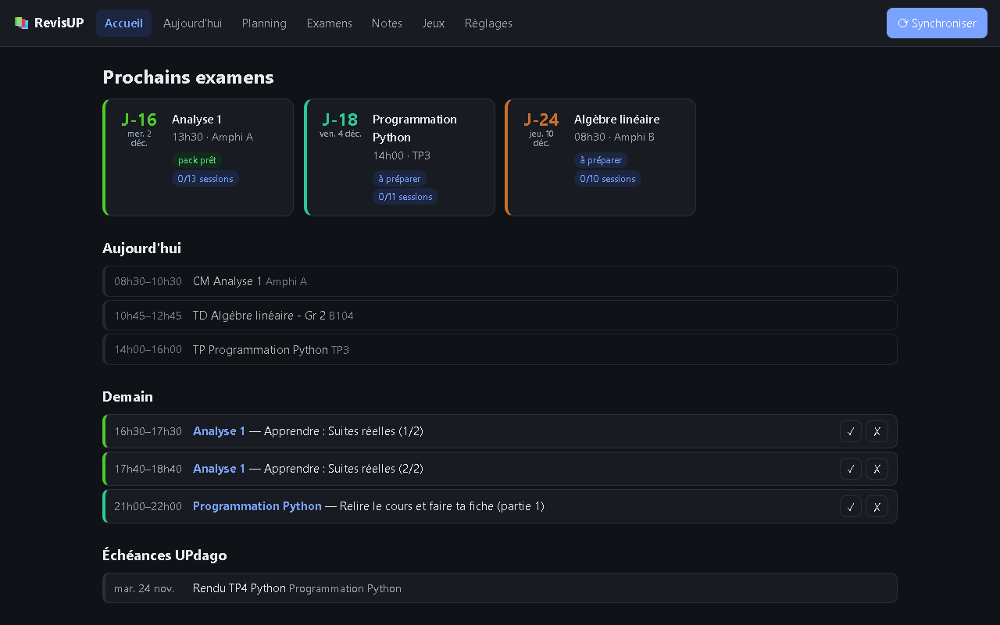
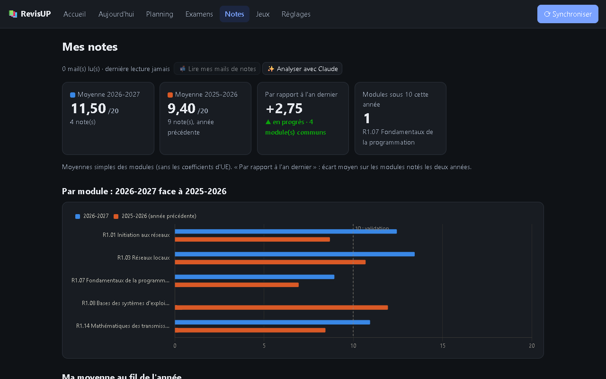
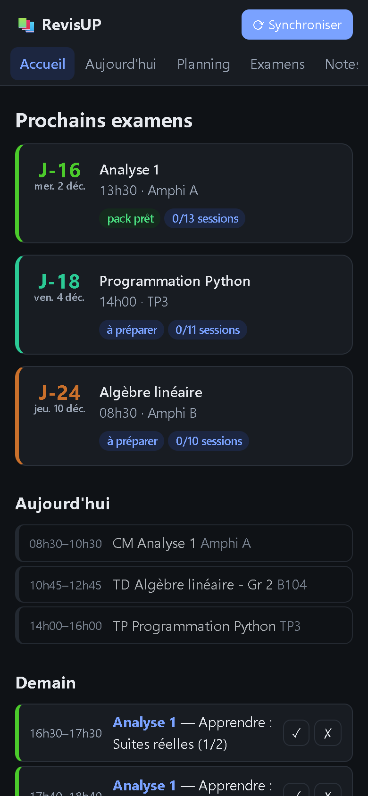
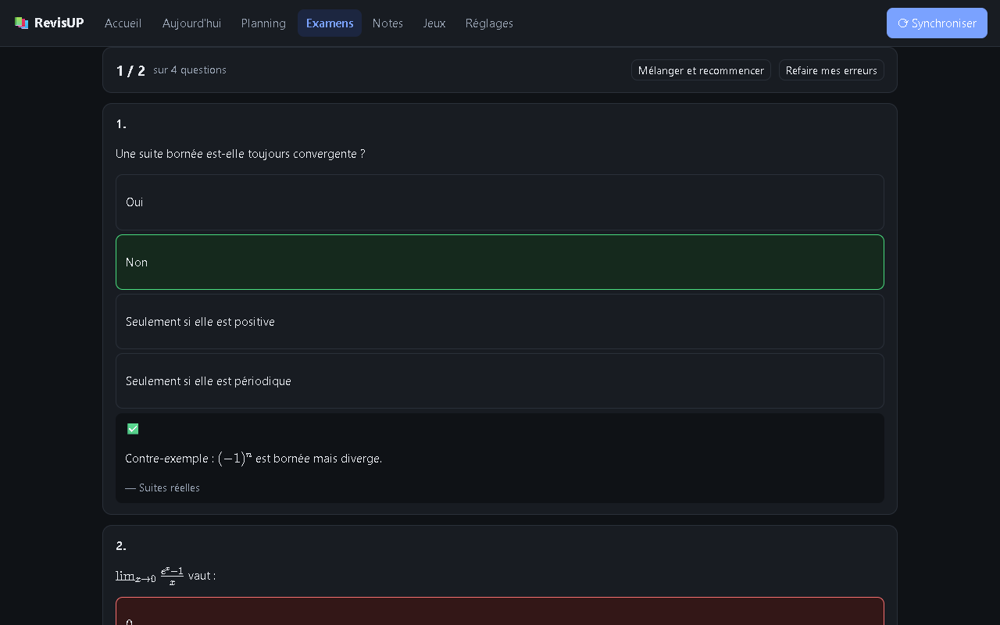
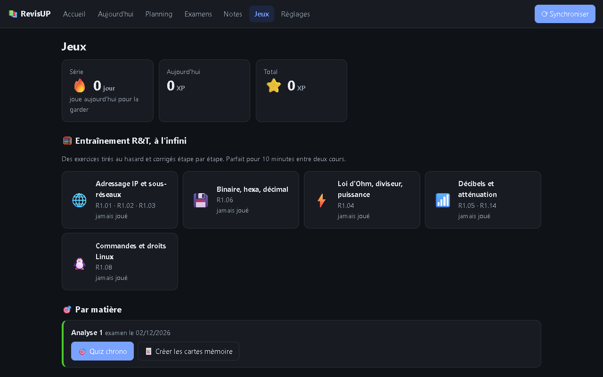
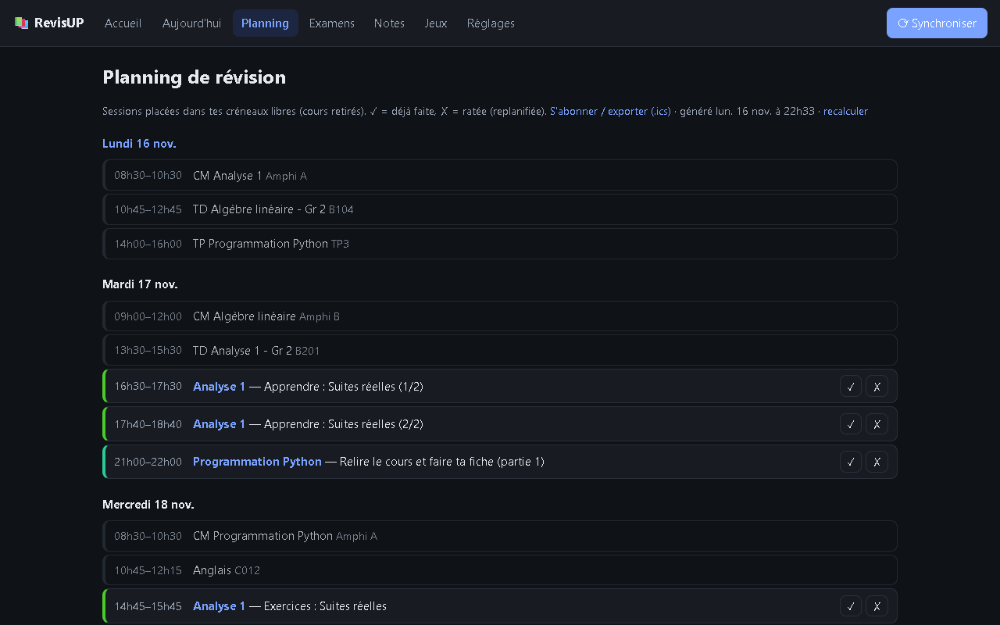

# 📚 RevisUP — assistant de révision par IA pour les étudiants de l'IUT de Poitiers (BUT Réseaux & Télécoms)

[](https://www.python.org/)
[](https://flask.palletsprojects.com/)
[](https://www.anthropic.com/claude)
[](#lapp-sur-liphone-web-app--notifications)
[](LICENSE)

**RevisUP prépare tes examens à ta place** : il lit ton emploi du temps, repère les partiels et les contrôles,
récupère tes cours sur Moodle, et l'IA en fait des **fiches de révision, des leçons, des QCM, des exercices
corrigés et des annales corrigées**, puis un **planning de révision** qui s'adapte à ta semaine.
Tout tourne sur ton PC : tes données restent chez toi.

🎓 **Né à l'IUT de Poitiers** : conçu par un étudiant du **BUT Réseaux & Télécoms (R&T) de l'IUT de Poitiers**
(Université de Poitiers), pour les outils de l'université : emploi du temps **UPplanning (ADE)**, Moodle **UPdago**,
messagerie de l'ENT et relevés de notes **ScoDoc**. Projet étudiant indépendant : ce n'est pas un outil officiel de l'IUT.

> 🇬🇧 *AI study assistant built by a student of the IUT de Poitiers (BUT Networks & Telecoms, France): reads your timetable (ADE / iCal) and Moodle courses,
> detects exams, and uses Claude + a local LLM (LM Studio) to generate revision sheets, lessons, quizzes,
> worked exercises, corrected past papers and a weekly study plan. Self-hosted Flask web app with a PWA for
> iPhone and Mac, push notifications and learning games. French UI.*

| Tableau de bord | Notes et progression | Sur iPhone |
|---|---|---|
|  |  |  |
| **QCM interactif** | **Jeux pour apprendre** | **Planning de révision** |
|  |  |  |

<sub>Captures du mode démo (`python -m revisup demo`) : données fictives.</sub>

## Ce que fait RevisUP

- 📅 **Détection des examens** dans l'emploi du temps (ADE / UPplanning, iCal) et dans les messages des profs.
- 📥 **Cours Moodle (UPdago)** : téléchargement et tri automatique (cours, TD, TP, annales, corrigés).
- 🧠 **Packs de révision par Claude** : fiche de synthèse, leçons vivantes, exercices corrigés, QCM, points clés, pièges.
- 📝 **Annales corrigées** question par question, avec le sujet affiché à côté.
- ⚡ **Schémas dessinés** : Claude lit les figures des sujets et redessine les montages (électricité, réseaux,
  chronogrammes) ; dans la correction, ce qu'il faut ajouter (nœuds, flèches de courant et de tension) est en orange.
- 📎 **Documents manquants** : ajoute un fichier du PC ou prends les pages en photo ; Claude les retranscrit.
- 💬 **Tuteur IA** sous chaque exercice : indices, méthode, vérification de ta réponse.
- 🗓️ **Planning de révision automatique** qui tient compte de tes cours, du sport et des trajets.
- 📊 **Suivi des notes** (relevés ScoDoc lus dans tes mails) et analyse de ta progression.
- 🎮 **Jeux** : quiz chrono, cartes mémoire (Leitner), exercices d'adressage IP, binaire, loi d'Ohm, Linux.
- 📱 **Web app pour iPhone et Mac** (PWA) avec notifications push : rappels J-7/J-1, programme du jour.

## Comment ça marche

RevisUP tourne sur ton PC et fait tout seul :

1. **Emploi du temps** : il lit ton EDT UPplanning (ADE) et repère les examens (partiel, CC, DS, contrôle, soutenance…).
2. **UPdago** : il lit tes cours, les annonces, les forums et tes messages privés. Si un prof annonce un examen
   par message (« le CC aura lieu le 19/11 à 10h15 en amphi Descartes »), l'examen est ajouté automatiquement.
3. **IA locale (LM Studio)** : elle trie tout sur ton PC. Elle trouve le cours UPdago de l'examen, classe les fichiers
   (cours, TD, TP, annales, corrigés) et extrait des messages des profs la salle, la durée, les documents autorisés et le programme.
4. **Claude** : à partir des fichiers téléchargés, il produit une **fiche de synthèse**, des **exercices corrigés**
   dans le style des annales, un **QCM** interactif et une estimation du temps de révision par chapitre.
   Puis il réécrit la fiche en **leçons vivantes**, une par chapitre : une situation concrète, une image pour
   comprendre, un exemple résolu pas à pas, le piège à éviter, la phrase à retenir et un défi.
   S'il y a des annales, il les corrige question par question (**Annale corrigée** : chaque réponse se déroule,
   d'après le corrigé du prof quand il existe).
   Sous chaque exercice, leçon ou question du quiz, **Demander à l'IA** ouvre une discussion avec un tuteur
   (IA locale) qui donne des indices sans gâcher la réponse.
5. **Planning** : tes sessions de révision sont placées dans tes trous d'EDT, avec une révision finale la veille de chaque examen.
6. **Notifications** sur Windows et sur l'iPhone (app ntfy) : nouvel examen, examen déplacé, J-14/J-7/J-3/J-1,
   programme du matin, début de session.

Tout se consulte sur le tableau de bord **http://localhost:8765**.

## Installation

1. Double-clique sur **`installer.bat`**.
2. Double-clique sur **`connexion.bat`** : une fenêtre Edge s'ouvre sur le CAS de l'université et tu te connectes.
   RevisUP récupère le jeton de l'app mobile Moodle (comme l'app officielle). Ton mot de passe n'est jamais lu.
3. Ouvre **`config.toml`** et colle l'URL iCal de ton emploi du temps dans `ical_url` :
   UPplanning ([lien](https://upplanning.appli.univ-poitiers.fr/direct/myPlanningUP.html)), puis choisis tes groupes,
   l'icône **Exporter l'agenda**, **Générer l'URL**, et copie le lien.
4. Dans **LM Studio**, télécharge le modèle `openai/gpt-oss-20b`. RevisUP démarre ensuite lui-même le serveur
   de LM Studio (commande `lms`) quand il en a besoin.
5. Double-clique sur **`demarrage-auto.bat`** : RevisUP démarre sans fenêtre, maintenant et à chaque ouverture de
   session Windows (journal dans `data\serveur.log`). Pour le lancer une seule fois avec une console : `lancer.bat`.
6. Messagerie (pour tes notes) : onglet **Notes** du tableau de bord, identifiant et mot de passe de l'ENT.
   La session de l'ENT expire au bout de quelques heures ; avec la **reconnexion automatique**, RevisUP remplit
   la page de l'ENT sans fenêtre et relit tes mails à chaque synchro. Le mot de passe est rangé dans le coffre de
   Windows (jamais dans un fichier), et il n'est essayé qu'une fois : s'il est refusé, il est effacé (pas de blocage
   du compte). Sans garder le mot de passe : bouton **ouvrir la page de l'ENT sur le PC**, à refaire à chaque expiration.
7. Si Claude Code se déconnecte : **`claude-connexion.bat`**.

### Connexions

RevisUP vérifie UPdago, la messagerie, Claude, l'IA locale et l'emploi du temps au démarrage puis toutes les 3 h.
Si l'une lâche, tu reçois une notification, et **Réglages → Connexions** a le bouton pour la réparer.

### Claude : trois modes (`[claude] mode` dans config.toml)

| Mode | Ce qu'il faut | Coût |
|---|---|---|
| `api` | une clé API Anthropic dans la variable `ANTHROPIC_API_KEY` | ~0,50 à 1 $ par examen avec Opus 5.5 |
| `cli` | Claude Code installé (commande `claude`) | inclus dans ton abonnement Claude |
| `manuel` | rien | tu copies le prompt dans claude.ai, puis tu recolles la réponse sur le tableau de bord |

En `auto`, RevisUP prend l'API si une clé existe, sinon Claude Code, sinon le mode manuel.

### L'app sur l'iPhone (web app + notifications)

1. Installe **Tailscale** sur le PC et l'iPhone (même compte), puis double-clique sur **`acces-iphone.bat`** :
   l'app devient accessible en HTTPS sur ton réseau privé Tailscale seulement (adresse dans `url_publique`).
2. Sur l'iPhone, ouvre cette adresse dans **Safari** → **Partager** → **Sur l'écran d'accueil**.
3. Ouvre RevisUP depuis son icône → **Réglages** → **Activer les notifications** (iOS 16.4 minimum).

Tu reçois alors les rappels d'examen, le programme du matin, la question de midi (« qu'est-ce que tu fais
aujourd'hui ? ») et les alertes de connexion. L'onglet **Aujourd'hui** adapte le planning à ta réponse, ou à ce
que tu écris librement (« jeudi pas de course, ciné de 20h à 23h »).

### Jeux

L'onglet **Jeux** propose un quiz chrono (QCM des packs, les erreurs reviennent), des exercices R&T générés
à l'infini et corrigés pas à pas (adressage IP, binaire/hexa, loi d'Ohm, décibels, Linux), des cartes mémoire
(boîtes de Leitner) et un jeu d'associations. Les cartes sont créées par l'IA locale à partir de chaque pack,
automatiquement à la synchronisation. Points d'expérience, série de jours et records.

Sans Tailscale : `hote = "0.0.0.0"` et `code_acces` dans `[web]`, puis `http://IP-DU-PC:8765/?code=…` sur le même Wi-Fi
(sans notifications : iOS les exige en HTTPS). Le fichier `planning.ics` s'importe aussi dans le Calendrier.

## Commandes

```
python -m revisup statut          état des connexions et examens détectés
python -m revisup tout            synchro + préparation + planning + rappels
python -m revisup examen "Anglais" 2026-12-10 10:00 --duree 90 --salle C012
python -m revisup preparer ID     (re)préparer le pack d'un examen
python -m revisup demo            essai avec des données fictives (dossier data-demo)
```

## Où sont mes données ?

Tout reste dans le dossier `data/` : `etat.json`, les packs dans `packs/` et les fichiers de cours téléchargés
dans `cours/`, rangés par matière et par catégorie. Le jeton UPdago est dans `data/secrets.json`.
Seuls les documents du cours concerné et les messages liés à l'examen partent chez Claude, au moment de générer le pack.
